# Hive-FS

**A distributed file system in Go, built from the Google File System paper.**

---

## Why a Google File System?

- **Easy horizontal scaling:** Capacity and throughput grow by **adding ordinary machines**, because metadata management and storage are decoupled.
- **Fault tolerance:** Chunks are replicated across machines, so a disk, machine, or rack failure **doesn't lose data or take the system down**.
- **High aggregate throughput:** Clients read and write **directly to many chunkservers in parallel**, so bandwidth scales with the number of servers.
- **Built for large files:** 64 MB chunks mean **fewer metadata entries and fewer master round trips**, which suits big sequential reads and writes.

---

## What is Hive-FS?

Hive-FS stores large files across many ordinary machines and **keeps working when some of them fail**.

A file is cut into 64 MB pieces called **chunks**, and each chunk is copied onto several different machines (**three by default**, configurable per chunk).

- **Master server:** Handles system metadata and coordination of chunkservers. It **never handles file data**, so it stays highly available to many clients.
- **Chunkservers:** Store the chunk copies on disk and serve the actual reads and writes.
- **Client:** Asks the master where a file's chunks are → then **talks directly to the chunkservers**.
- **POSIX-like client interface:** Files are handled through an interface modeled on POSIX.
- **Automatic re-replication:** Data that loses a copy is re-copied without intervention.
- **Transactions:** Every operation that mutates metadata is wrapped in a transaction, which is **logged first and then applied**.
- **Crash tolerance:** The master survives a process crash through a replayable **Write-Ahead Log (WAL)** and periodic **checkpoints**.

---

## Project layout

| Path | Purpose |
|---|---|
| `cmd/master` | Entry point for the master server |
| `cmd/chunkserver` | Entry point for the chunkserver |
| `client/` | Go client library used by applications |
| `internal/master` | Master package|
| `internal/chunkserver` | Chunkserver package |
| `internal/hive` | Hive Protocol Package |
| `internal/messages` | Generated protobuffer Go code |
| `proto/gfs/v1` | Protobuffers definitions (`master`, `chunkserver`, `client`, `common`) |

## Build and test

```bash
# Build everything
go build ./...

# Build the binaries
go build -o bin/master ./cmd/master
go build -o bin/chunkserver ./cmd/chunkserver

# Run all tests (some e2e tests are flaky so if it fails re-run them)
go test -race ./...

# Run tests for a single package
go test -race ./internal/master/...
go test -race ./internal/chunkserver/...
go test -race ./internal/hive/...

```

## Contents

| Section | What it covers |
|---|---|
| [Overview](#overview) | Architecture, master, chunkserver and client |
| [Communication and Transport](#communication-and-transport) | Custom Wire framing, multiplexing and streams |
| [Write operation](#write-operation) | Two-phase write through the primary |
| [Record append](#record-append) | Atomic, at-least-once appends |
| [Snapshots and Copy-on-Write](#snapshots-and-copy-on-write) | Instant copies with reference counting |
| [Read operation](#read-operation) | Locating and streaming chunk data |
| [Create, List and Move operations](#create-list-and-move-operations) | Namespace operations and path locking |
| [Delete operation and Garbage Collection](#delete-operation-and-garbage-collection) | Lazy deletion and chunk reclamation |
| [Transactions and Write-Ahead Log (WAL)](#transactions-and-write-ahead-log-wal) | Logging, checkpoints and crash recovery |
| [Re-replication](#re-replication) | Keeping chunks at their replication factor |
| [Versions and replica detection](#versions-and-replica-detection) | Detecting stale replicas |
| [Data integrity](#data-integrity) | Checksums and scrubbing |
| [How Hive-FS implements the GFS consistency model and failure handling](#how-hive-fs-implements-the-gfs-consistency-model-and-failure-handling) | GFS behaviors mapped to Hive-FS mechanisms |
| [Limitations](#limitations) | What is not implemented |

## Overview

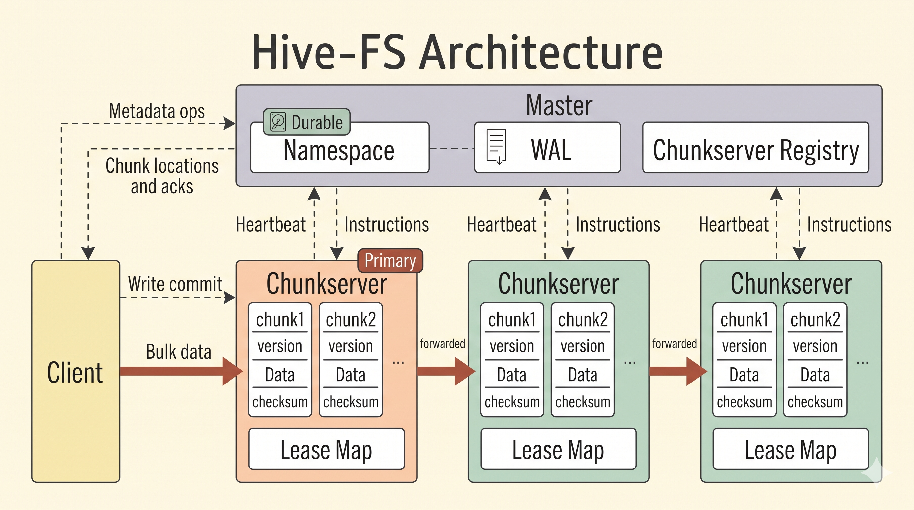

<details>
<summary><b>Master</b></summary>

<br>

The master is the metadata server of Hive-FS. It decides **where data lives** and **which replica orders each write**. It never handles file data, so it stays small and fast.

**It tracks three things:**

- **The namespace:** Directories and files addressed by path. Each file maps to an ordered list of chunk handles.
- **The chunk table:** For every chunk, its version, reference count, replication factor, primary and lease expiry.
- **The chunkserver registry:** Which chunkservers are alive and what each one holds, built from heartbeats.

The namespace and chunk table are **durable**. Chunk locations are **not**: after a restart the master relearns them from heartbeats, because *chunkservers are the ground truth* about what is on their disks.

**What it does:**

- **Serving requests:** Answers metadata operations (create, move, delete, snapshot, list) and tells clients which chunkservers hold their chunks. For writes, it grants a **time-limited lease** to one replica, the **primary**, which orders all mutations on that chunk.
- **Handling heartbeats:** Each heartbeat refreshes the registry, and the reply carries instructions back, such as deleting chunks the master no longer knows about.
- **Background maintenance:** A **garbage collector** reclaims chunks of deleted files, and a **replication loop** re-copies chunks that lost a replica and trims chunks that have too many.

Every mutation is written to a checksummed write-ahead log and **fsynced before it is applied in memory**. After a crash, the master loads its latest checkpoint and replays the log to its **exact prior state**.

</details>

<details>
<summary><b>Chunkserver</b></summary>

<br>

Chunkservers are the storage layer of Hive-FS. Each one stores chunk replicas on its local disk and **serves reads and writes directly to clients**.

**Each chunk is stored as:**

- **Chunk file:** The data, up to 64 MB.
- **Checksums:** One checksum per **64 KB block**.
- **Version:** The chunk's version number.

State is rebuilt from disk at boot. In memory, each server keeps its chunk set (with each chunk's checksum table and serial counter), a version map, a lease map, and the buffers for pushed data.

**What it does:**

- **Receiving data:** The client pushes data, and each server holds it in an **in-memory buffer** while forwarding it to the next replica as it arrives. *Nothing touches disk at this stage*, and unused buffers expire with a TTL.
- **Committing writes:** The client sends a commit to the **primary**, the replica holding the lease. The primary stamps the write with the next **serial number**, sends it to the secondaries, and applies it locally last, so **every replica applies writes in the same order**. A secondary rejects a write whose version differs from its own, which drops delayed writes from an old lease.
- **Serving reads:** The checksums of the blocks touched are verified **before any data is returned**. Corruption fails the read, so the client can try another replica. A background **scrubber** also verifies chunks nobody is reading.
- **Talking to the master:** A **heartbeat every 10 seconds** reports the chunks held and their versions. The reply carries instructions, such as deleting a chunk or pulling a copy from another chunkserver. The master also sends lease grants, revocations and version updates.

A replica that missed a mutation or holds corrupted data is **detected and dropped from service** instead of serving stale or bad bytes.

</details>

### Client

The client is a Go library that applications use to talk to Hive-FS. It exposes two groups of operations.

#### Namespace operations

Each is a **single request to the master**, and works on a whole directory in one call.

| Method | Description |
|---|---|
| `Create(ctx context.Context, name string) error` | Creates a new entry in the namespace. |
| `Delete(ctx context.Context, path string) error` | Removes the entry at the given path. |
| `List(ctx context.Context, path string) ([]string, error)` | Returns the names under the given path. |
| `Move(ctx context.Context, src string, dst string) error` | Moves or renames an entry from `src` to `dst`. |
| `Snapshot(ctx context.Context, src string, dst string) error` | Creates a snapshot of `src` at `dst`. |

#### Data operations

| Method | Description |
|---|---|
| `GetFileInfo(ctx context.Context, path string, offset int64, length uint32) (*FileInfo, error)` | Returns the chunk layout (ids, versions, locations) for a byte range of a file. |
| `Read(ctx context.Context, req *ReadRequest) (io.ReadCloser, error)` | Streams the requested byte range of a file. |
| `Write(ctx context.Context, path string, offset int64, size uint32, data io.Reader) error` | Writes `size` bytes from `data` at the given offset. |
| `RecordAppend(ctx context.Context, path string, record *Record) (int64, error)` | Appends a record to the file and returns the offset it landed at. |

**Chunk location cache:** The client keeps a small cache of chunk locations, keyed by **path and chunk index**. Each entry carries the lease expiry returned by the master, and is dropped when the lease runs out or when an operation on that chunk fails. This **saves a master round trip** on repeated access to the same chunk.

---

## Communication and Transport

### Custom framing and request multiplexing

- **Framing:** Every message is a fixed **16-byte header** followed by the payload.
- **Multiplexing:** Every request carries an ID, and the reply echoes it back. This allows **multiple requests on the same connection** and prevents head-of-line blocking.

### Control connections and streams

- **Streams:** A single header frame opens the stream, then the data follows without further framing. A **running checksum** is computed as the data flows and sent **once at the end**, so corruption is caught per transfer with no per-frame overhead.

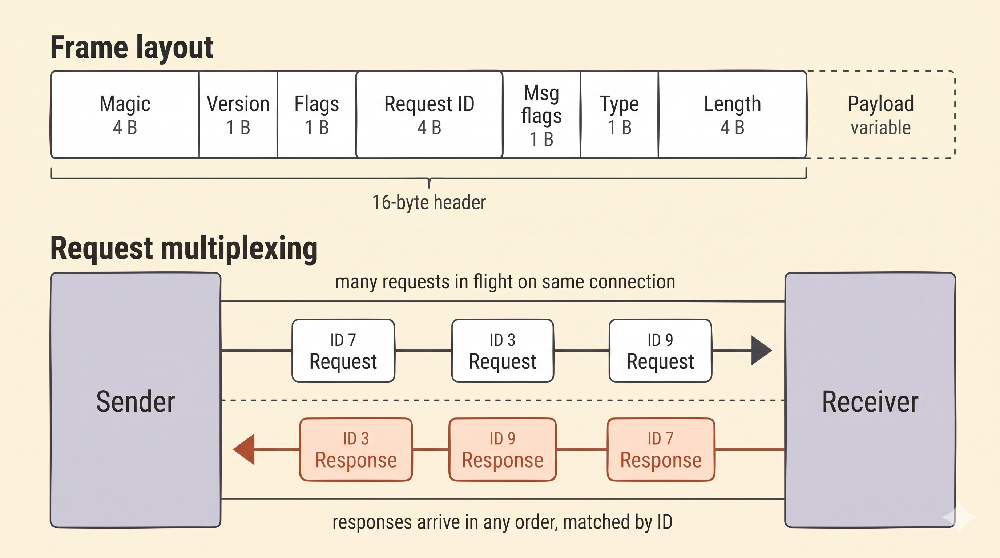

---

## Write operation

A write is a **two-phase operation**: data is pushed to every replica first → then committed through the primary.

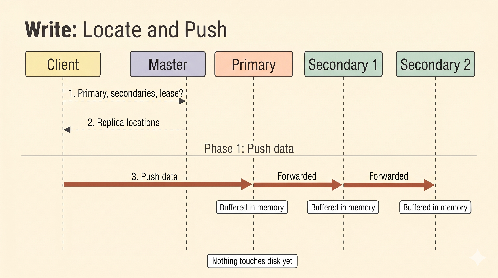

1. **Locate:** The client converts `(file, offset)` → `(file, chunk index, offset)` and gets the primary, secondaries and lease from the master. If the chunk is shared with a snapshot, the master **forks it first** (see [Snapshots and Copy-on-Write](#snapshots-and-copy-on-write)).
2. **Phase 1, push:** The client streams the data to the first replica, and each chunkserver forwards it down the chain while buffering it in memory. *Nothing touches disk yet.*

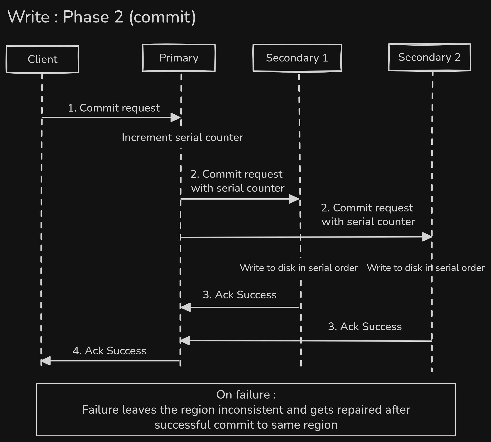

3. **Phase 2, commit:** The client sends a commit to the primary. The primary **assigns the write a serial number** and sends a commit message with that number to the secondaries. The secondaries flush the buffered data in serial-number order, so **every replica applies writes in the same order**.
4. **Failure:** If any secondary fails, the primary applies nothing and the client **retries with the same serial number**. If the commit gets no reply, the client reports the region as **inconsistent**.

---

## Record append

The client supplies only the data, and the **primary chooses the offset**. Many clients can append to the same file at once **without coordinating**.

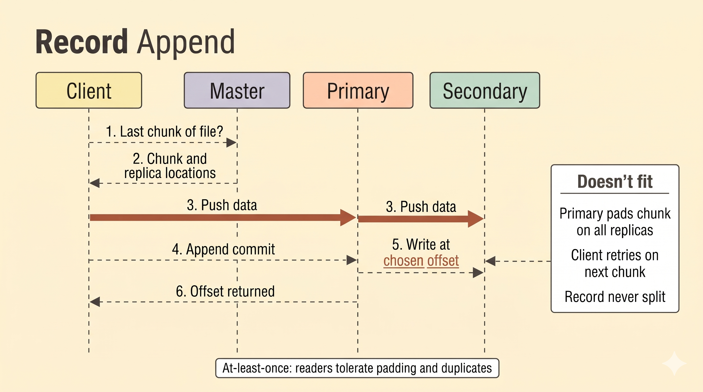

- **Locate:** The client asks the master for the file's last chunk. The push and commit work as in [Write](#write-operation), with the offset left for the primary to choose.
- **Result:** Once the chunkservers have written the buffer successfully, the offset chosen by the primary is returned to the client.
- **Overflow:** If the record doesn't fit, the primary **pads the chunk to full size** on every replica. The client moves to the next chunk and retries, up to a fixed number of attempts. *A record is never split across chunks.*
- **Failure:** A failed append is retried, so a record can appear more than once on some replicas.

> ⚠️ Appends are **atomic and at-least-once**, so readers must tolerate **padding and duplicates**.

---

## Snapshots and Copy-on-Write

A snapshot copies a file or a whole directory **instantly**, because no data is copied until something changes.

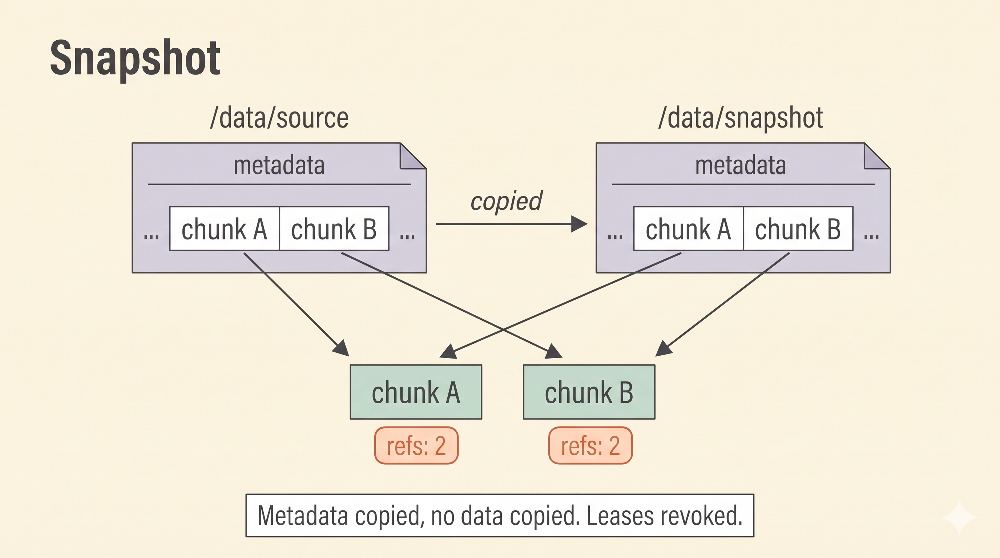

- **Snapshot:** Makes a shallow copy of a file or a **whole directory tree** (the "source") instantaneously, by copying metadata and **incrementing the reference counters** of the affected chunks. It revokes the leases on those chunks, so the next write has to go through the master.

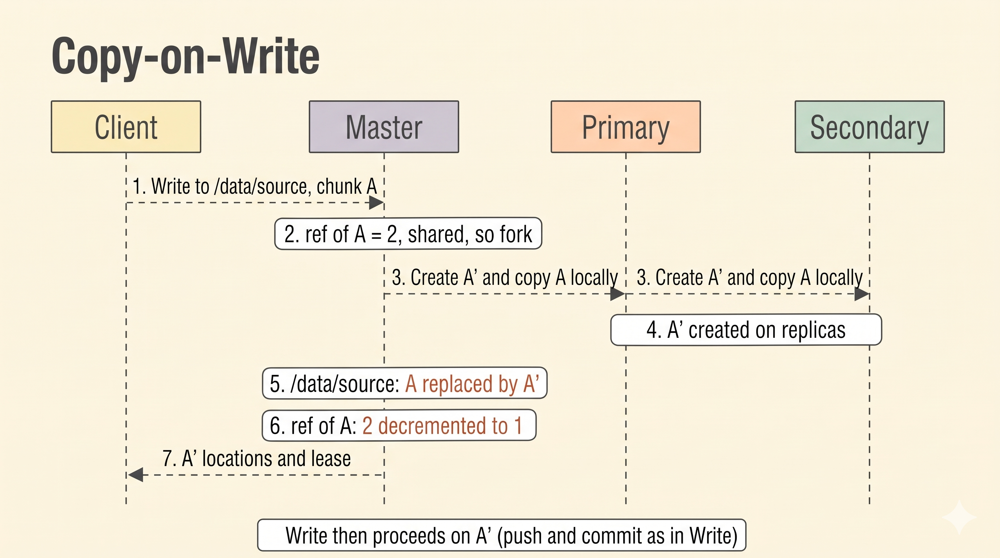

- **Copy-on-Write (CoW):** If a chunk's **reference count is above 1**, the master forks it before the write proceeds. It creates a new chunk and instructs every replica to make a local copy of the old chunk under the new chunk ID. The new ID replaces the old one in the file's metadata, and the old chunk's reference count drops by one.

---

## Read operation

A read never involves the master beyond a **metadata lookup**. Data comes straight from a chunkserver.

- **Locate:** The client converts `(file, offset, length)` into the chunk range it covers and asks the master for each chunk's handle, version and replica locations.
- **Stream:** For each chunk, the client opens a stream to one replica. The chunkserver **verifies the checksums of the blocks it touches**, then streams the data followed by a single checksum.

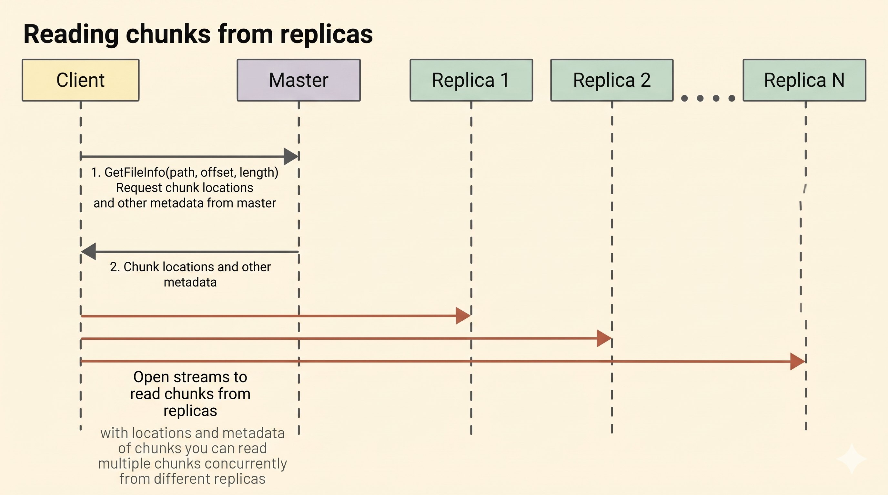

---

## Create, List and Move operations

All three are **single requests to the master** and need no chunkserver. Paths are validated, and every operation takes **path locks** to prevent conflicting concurrent operations.

To prevent deadlocks between routines, locks are taken in a **fixed order**: first by path depth in the namespace tree, then lexicographically within the same level.

- **Create:** Adds an empty file to the namespace.
- **List:** Returns the contents of a directory.
- **Move:** Renames a file or a whole directory in **one atomic operation**, however many files it contains.

---

## Delete operation and Garbage Collection

Deleting is **lazy**, so it never waits on chunkservers.

- **Delete:** The master moves the file or directory to a hidden deleted namespace with a timestamp. It disappears from the namespace immediately, and the change is a **single logged transaction**.
- **Collect:** After a grace period, a background garbage collector decrements the reference count of each chunk the deleted files used, in bounded batches, and removes chunks that reach 0 from the chunk table.
- **Reclaim:** Chunkservers still holding those chunks report them in their next heartbeat. The master doesn't recognize them, and the reply tells the chunkserver to delete them.

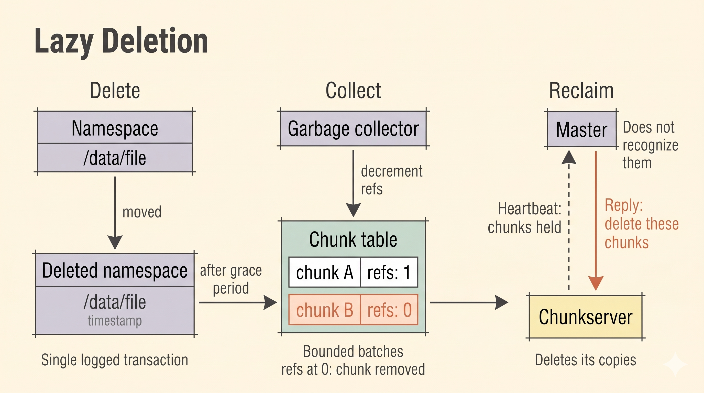

---

## Transactions and Write-Ahead Log (WAL)

Every namespace and chunk table change goes through the same path.

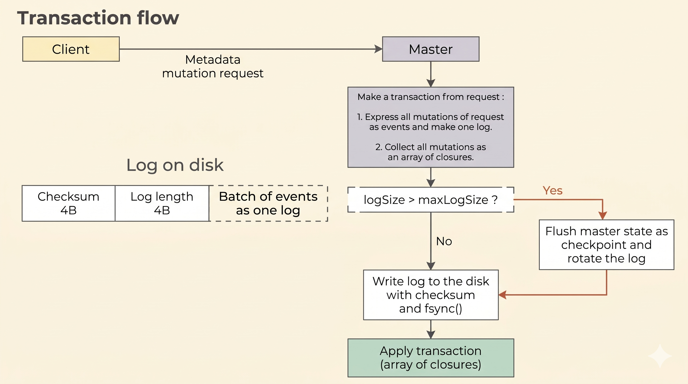

1. **Transaction:** A request collects all the changes it makes into one transaction. If it fails before committing, the changes **roll back**.
2. **Log first:** The transaction is written to the WAL as checksummed records and **fsynced**. Only then is it applied in memory and acknowledged.

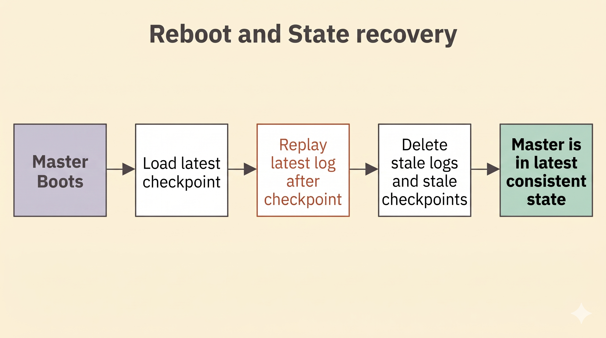

- **Checkpoint:** When the log reaches a fixed size, the master saves a checkpoint of its full state and starts a new log.
- **Recovery:** After a crash, the master loads the latest checkpoint and replays the remaining log.
- **Idempotent replay:** Replays are idempotent where possible and otherwise guarded with checks, so **applying a record twice never corrupts the state**.
- **Exact restoration:** Replaying is safe, so the master returns to its exact prior state.
- **Chunk locations:** These are **not logged**, and come back through heartbeats.

---

## Re-replication

A background loop on the master keeps every chunk at its **replication factor**.

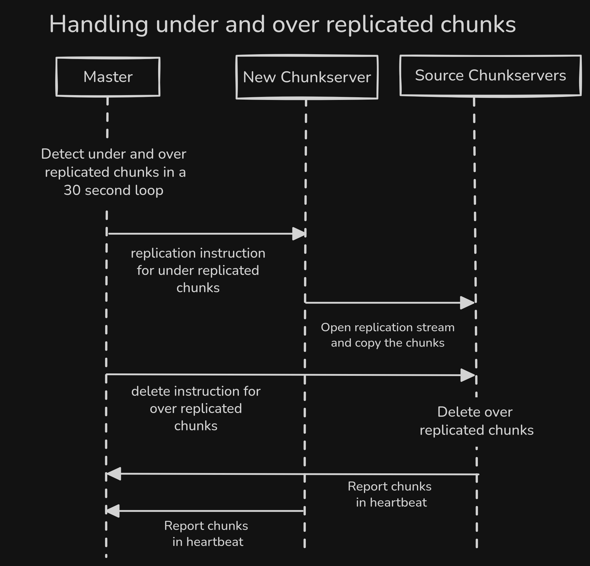

1. **Detect:** Every **30 seconds** the master drops dead chunkservers and compares each chunk's live replica count to its replication factor.
2. **Under-replicated:** Chunks with the **fewest surviving replicas are repaired first**, a limited number per round. The master picks chunkservers that don't already hold the chunk and tells each to pull a copy from a live replica. Pending requests are tracked, so the same copy isn't requested twice.
3. **Over-replicated:** The master tells the extra replicas to delete their copy, **never the primary**.
4. **Lost chunks:** A chunk with no live replica has nothing to copy from and is **skipped**.

---

## Versions and replica detection

Every chunk has a **version number** that increases each time the master grants a new lease.

- **Persisted on both sides:** The master logs the version, and each chunkserver stores it in the chunk's version file.
- **Checked on writes:** A secondary rejects a write whose version differs from its own, so **a delayed write from an old lease is dropped**.
- **Checked by heartbeats:** Chunkservers report their versions. A replica that was down during a change comes back with an old version, and the master excludes it, so **clients are never sent to stale data**.

---

## Data integrity

- **Block checksums:** Each chunk is divided into **64 KB blocks**, each with its own checksum, stored in the chunk's checksum file.
- **Verified on every operation:** Reads verify the blocks they touch, and writes verify the range they overwrite.
- **Scrubber:** A background scrubber verifies stored chunks on a schedule, to catch corruption in data **nobody is reading**.
- **On corruption:** The operation fails, so the client moves to another replica. The chunkserver drops the corrupted replica, and re-replication restores it from a healthy one.
- **In transit:** Streams carry their own checksum, so corruption on the network is caught at the end of each transfer.

---

## How Hive-FS implements the GFS consistency model and failure handling

| GFS behavior | How Hive-FS meets it |
|---|---|
| Namespace operations are atomic | Path locks, and **one logged transaction** per operation |
| All replicas apply mutations in the same order | The lease-holding primary assigns **serial numbers**, so a successful write leaves the region *defined* |
| Record append is atomic, at least once | The data lands as one contiguous record at an offset the primary picks. Retries may leave **duplicates or padding** |
| Failed mutations are visible as failures | A failed write leaves the region *inconsistent*, and the client retries |
| Stale replicas are detected and never served | **Chunk versions**, checked on writes and heartbeats. Out-of-date replicas are excluded from reads and writes |
| Corruption is detected | **64 KB block checksums**, verified on every operation and by the scrubber |
| Lost replicas are re-created | **Re-replication**, fewest surviving replicas first |
| Snapshots are cheap | **Copy-on-write** with reference counts |
| The master survives recoverable crashes | **Fsynced WAL**, checkpoints and idempotent replay |

---

## Limitations

- **No shadow masters:** Not implemented.
- **Metadata is not scalable:** It cannot be sharded, replicated or scaled across machines.
- **Single point of failure:** The master survives a process crash and reboots to a valid state, but it **cannot survive a permanent machine failure**.
- **No erasure coding:** It could cut replication storage cost by about **50%**, but it costs extra CPU and adds network latency. GFS already trades latency for other benefits, so it could be added to a system like this.